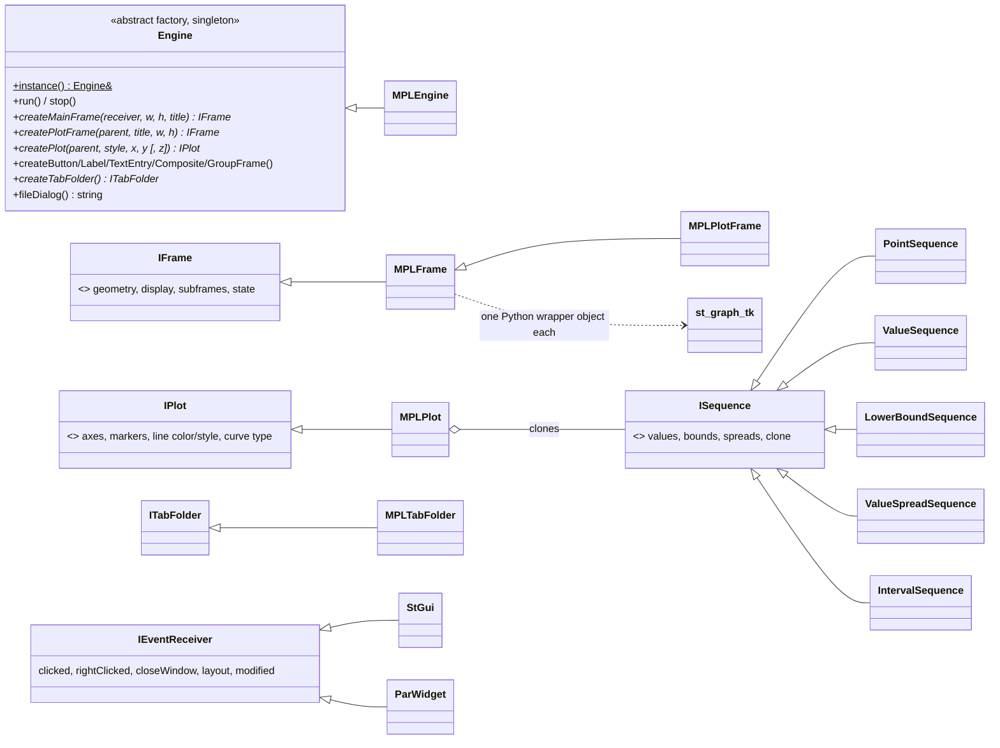

# st_graph Architecture

**st_graph** gives C++ tools a small, engine-neutral API for plots (1-D
histograms, scatter plots with error bars, 2-D lego/surface plots) and for
simple GUI widgets (frames, buttons, labels, text entries, tab folders,
file dialogs). It also provides `StGui`, a generic parameter-file GUI built
from those widgets.

Only one engine is compiled: **`MPLEngine`**. It drives Tk and matplotlib
through a Python interpreter embedded in the C++ process. The Python side
is the module `st_graph_tk` (`src/st_graph_tk.py`). The original ROOT
engine (`Root*.cxx`) remains in the tree but is not built.

`src/mainpage.h` was updated with the MPL rewrite and describes the engine
correctly. Its sample code (`createPlotHist1D`, `PlotHist`) refers to an
API that no longer exists; see `src/test/test_st_graph.cxx` for working
calls.

## Purpose and scope

**Does:**
- Define abstract interfaces: `Engine` (abstract factory and event loop),
  `IFrame`, `IPlot`, `ITabFolder`, `IEventReceiver`.
- Adapt arbitrary iterator ranges into plot data (`ISequence` and its
  templates), including bin edges, error bars and spreads.
- Lay out widgets explicitly (`Placer.h`: `LeftEdge`, `RightEdge`,
  `TopEdge`, `BottomEdge`, `Center`).
- Provide `StGui`, a parameter GUI for any `hoops::IParGroup`, with one
  widget per parameter, switch-driven tabs, an "advanced" (hidden)
  toggle, and an optional plot pane.
- Implement all of this with Tk, matplotlib and numpy (and scipy for
  smoothed curves), keeping the C++ code safe from floating-point traps
  while Python runs.

**Does not:**
- Write plot files for users. There is no batch or headless output path,
  except the test hook `ST_GRAPH_SNAPSHOT_DIR`.
- Work without a display. With no display, every create call throws.
- Provide plotting for `gtlike`. `Likelihood` draws its counts-spectrum
  plots with its own `EasyPlot`/`matplotlibcpp` code (see below).
- Know about `StApp`. The st_app-aware GUI (`st_app::StAppGui`) lives in
  `st_app`.

## Position in the system

| Direction | Package | Why |
|-----------|---------|-----|
| Depends on | Python 3 (`Python3::Python`, PRIVATE) | Embedded interpreter (`src/EmbedPython.cpp`). Needs `tkinter`, `matplotlib` and `numpy` at runtime (`scipy` optional). |
| Depends on | `hoops` (PUBLIC) | `st_graph/StGui.h` takes a `hoops::IParGroup` and builds widgets from `hoops::IPar`. |
| Depends on | `st_stream` (PUBLIC) | `StGui` and `ParWidget` hold `StreamFormatter`s. |
| Linked, unused | `embed_python` (PRIVATE) | Listed in `target_link_libraries`, but no st_graph source includes an `embed_python` header. st_graph has its **own** `EmbedPython.h/.cpp` (namespace `st_graph`, functions `EP_*`). The link can probably be dropped (inferred from reading; not tried). |
| Used by | `st_app` | `StApp::runGui` (default `StEventReceiver` GUI), `StApp::getPlotFrame`, and `st_app::StAppGui : st_graph::StGui`. Every tool therefore links st_graph, and `gui=yes` on any tool runs through it. |
| Used by | `burstFit` | `gtburstfit` and `test_burstFit`: histogram plots of light curves, Bayesian blocks and fits, residual plots, draggable markers, `rightClicked` handling, and an `StAppGui` subclass. This is the **only real plotting client**. |
| Used by | `Likelihood` | **Include-only, vestigial.** `likelihood.cxx` includes `Engine.h`, `IFrame.h` and `Placer.h`, and `EasyPlot.h` includes `IPlot.h`, but no `st_graph::` symbol is used. `gtlike plot=yes` uses `EasyPlot` → `matplotlibcpp.h`, a separate embedded-Python path. `Likelihood` and `gtlike` still link st_graph. |

`docs/architecture/dependency-layers.md` lists `embed_python` as an
st_graph dependency. That is true of the CMake link but not of the code.

## Key abstractions

All public types are in namespace `st_graph`. Headers are in `st_graph/`.
MPL implementation classes are in `src/`, except `MPLFrame.h`, which is
installed.



| Type | Header | Role |
|------|--------|------|
| `Engine` | `st_graph/Engine.h` | Abstract factory for every graphical object, plus the event loop (`run` blocks in Tk `mainloop` until `stop`). `Engine::instance()` returns a function-static `MPLEngine` (`src/Engine.cxx`, selected because `ROOT_PLOTTING` is not defined). |
| `IFrame` | `st_graph/IFrame.h` | A rectangle in a widget tree: geometry (`L/R/T/B`, centres, width and height, minimums), `display`/`unDisplay`, hidden flag, subframes, string *state* (button up/down, entry text), tooltip. |
| `IEventReceiver` | `st_graph/IEventReceiver.h` | Callback interface with no-op defaults: `clicked`, `rightClicked(x, y)`, `closeWindow`, `layout`, `modified(text)`. Clients subclass it to handle events and lay out frames. |
| `IPlot`, `Axis`, `Marker`, `Color` | `st_graph/IPlot.h`, `st_graph/Axis.h` | A plot inside a plot frame. Axes have title and linear/log scale. Markers can be dragged by the user, and their new positions are read back with `getMarkers`. Colours are an enum mapped to matplotlib single-letter colours. |
| `ISequence` and templates | `st_graph/Sequence.h` | Header-only adapters from iterator ranges to (value, low, high) triples. `PointSequence`: sharp points. `ValueSequence`: centres, with bounds from neighbours. `LowerBoundSequence`: lower edges, with the rest from neighbours. `ValueSpreadSequence`: explicit spreads. `IntervalSequence`: explicit [low, high). |
| `HPlacer`/`VPlacer` and friends | `st_graph/Placer.h` | Explicit layout helpers: `LeftEdge(f).below(TopEdge(g), 5)` style. |
| `ITabFolder` | `st_graph/ITabFolder.h` | Tab pages keyed by label. `getSelected()` returns the active label. |
| `StGui`, `ParWidget` | `st_graph/StGui.h` | Generic parameter GUI over a **clone** of a `hoops::IParGroup`. Its abstract `runApp()` is called when Run is pressed. Reads `plot` to decide whether to add a plot pane. |
| `MPLEngine` | `src/MPLEngine.h` | Implementation. Its constructor calls `EP_Init()` and `MPLFrame::ancestor()`; any exception sets `m_init_succeeded = false`. |
| `MPLFrame`, `MPLPlotFrame`, `MPLPlot`, `MPLTabFolder` | `st_graph/MPLFrame.h`, `src/` | Each C++ frame owns one Python wrapper (`Frame`, `MainFrame`, `PlotFrame`, …) from `st_graph_tk`. The C++ side keeps the geometry and pushes it to Tk's `place` manager. `MPLPlotFrame` gathers its `MPLPlot`s and calls `plot_hist`, `plot_scatter` or `plot_lego` on the Python `PlotFrame` (a matplotlib `Figure` in a `FigureCanvasTkAgg`, with toolbar). |
| `PythonFpeGuard`, `ApplicationFpeScope` | `src/EmbedPython.h` | Save the FP environment, disable traps (`feholdexcept`) around every Python call, and restore the application's environment (with traps) around C++ callbacks invoked from Python. |
| `EP_*` helpers | `src/EmbedPython.h` | `EP_Init`, `EP_Helper` (imports `st_graph_tk` once), `EP_CallHelper`, `EP_CallMethod`, `EP_FromVector`, `EP_ErrorMessage`, and `PyRef` (RAII reference). |

## Data flow and control flow

### Creating and showing a plot (what `gtburstfit` does)

```
Engine & engine = Engine::instance()          // first call: Py_InitializeEx(0); import st_graph_tk;
                                              //   st_graph_tk.Ancestor() → hidden tk.Tk() root
IFrame * pf = app.getPlotFrame("title")       // st_app: createMainFrame(0, 638, 319) + createPlotFrame
IPlot * p = engine.createPlot(pf, "hist",
              LowerBoundSequence(edges...), PointSequence(counts...))
p->setLineColor(Color::eRed)
engine.run()
  MPLFrame::ancestor()->display(); hideHidden(...)
  st_graph_tk.mainloop()                      // blocks; MPLPlotFrame draws via PlotFrame.plot_* / finish / draw
  ... user closes the window → DefaultReceiver::closeWindow → engine.stop() → st_graph_tk.quit()
```

`createPlot(title, w, h, style, x, y)` (no parent) is a convenience
overload. It makes its own main frame and plot frame, and they are deleted
along with the plot.

### Events from Tk back to C++

1. Each `MPLFrame` gets an integer id and is registered in a static
   `liveFrames()` map.
2. `createCallback()` builds a Python builtin (`st_graph_dispatch`) that is
   bound to that id. The Python wrapper calls it with
   `('clicked',)`, `('modified', text)`, `('close',)`, `('layout',)`,
   `('rightClicked', x, y)` or `('markerMoved', plot, marker, x, y)`.
3. `dispatchEvent` looks up the frame. If the frame has been deleted, the
   event is ignored. It then calls `handleEvent` inside an
   `ApplicationFpeScope`, which routes to the frame's `IEventReceiver`.
4. A C++ exception in a handler becomes a Python `RuntimeError`.

### `StGui` parameter GUI

1. The constructor clones the par group and reads `plot`.
2. `run()` creates the main frame, the Run, Cancel and "Show Advanced
   Parameters" buttons, and one `ParWidget` per parameter. Switch
   parameters with enumerated ranges become tab folders.
3. It then calls `Engine::run()`.
4. **Run** copies the widget values into the clone and calls the subclass's
   `runApp()`. `st_app::StAppGui::runApp` copies them into the app's real
   group, then calls `Save()` and `app.run()`.

## Public interfaces

### C++ API

| Header | Used by |
|--------|---------|
| `st_graph/Engine.h` | `st_app`, `burstFit` (and `Likelihood`, unused) |
| `st_graph/IFrame.h`, `IPlot.h`, `Sequence.h` | `burstFit` (and `Likelihood`, unused) |
| `st_graph/IEventReceiver.h`, `ITabFolder.h`, `Placer.h`, `StGui.h` | `st_app` (public headers `st_app/StGui.h`, `st_app/StAppGui.h`) |
| `st_graph/MPLFrame.h` | Internal. Installed because `MPLEngine` and `MPLTabFolder` need it; forward-declares `PyObject`. |
| `st_graph/RootFrame.h`, `LinkDef.h` | **Dead.** Installed but they include ROOT headers, which are not available. Including them fails. |

Plot `style` strings are matched loosely (`MPLPlot::setStyle`, case
insensitive):
- contains `h` → `hist`
- else contains `l` → `lego`
- else contains `sc` → `scat`
- else contains `su` → `surf`
- otherwise `std::logic_error`.

`lego` and `surf` need the 3-D `createPlot` overload that takes `z`.

### Applications

None for users. `test_st_graph` is installed to `bin` (see below).

### Python

- `st_graph_tk.py` is installed to `${FERMI_INSTALL_PYTHON}`
  (`site-packages/fermitools`). That directory is on `sys.path` through
  the `fermitools.pth` file written by the top-level `CMakeLists.txt`.
  It is an implementation module, not a user API.

### Environment variables

Read only by `st_graph_tk.py` (the C++ sources call no `getenv`):
- `ST_GRAPH_AUTO_CLOSE_MS=<ms>` makes every `mainloop()` return after
  that delay.
- `ST_GRAPH_SNAPSHOT_DIR=<dir>` saves `st_graph_NNN.png` each time a
  plot is drawn.

Variables set by conda activation are described under "Runtime
environment" in ScienceTools' `docs/architecture/README.md`.

### File formats

None, apart from the optional PNG snapshots.

## Build and test

- **CMake target:** `st_graph` is a **STATIC** library. The sources built
  are `Axis`, `EmbedPython`, `Engine`, `IPlot`, `MPLEngine`, `MPLFrame`,
  `MPLPlot`, `MPLPlotFrame`, `MPLTabFolder` and `StGui`. **No `Root*`,
  `STGMainFrame` or `STGLayoutManager` sources are compiled**, and
  `ROOT_PLOTTING` is never defined. `TRAP_FPE` is defined on non-Apple
  systems but is not referenced by any compiled st_graph source.
- **Install:**
  - headers go to `include/st_graph`
  - `pfiles/test_st_graph.par` goes to `syspfiles`
  - `st_graph_tk.py` goes to the Python dir
  - `test_st_graph` goes to `bin`
- **`test_st_graph`** (`src/test/test_st_graph.cxx`):
  - It has its own `main` (not st_app). It is **not registered with
    CTest**.
  - **With no arguments it does nothing and exits 0.** Pass any argument
    to run the tests.
  - The tests are `testGuis` (an `StGui` over `test_st_graph.par`, so
    `PFILES` must find it, plus a hand-built widget GUI), `testSequence`
    (non-graphical checks of every `ISequence` type), `testPlots`, and a
    set of sine-wave histogram, scatter and lego plots.
  - The tests need a display, Tk and matplotlib, and they wait for the
    user to close windows. Set `ST_GRAPH_AUTO_CLOSE_MS=2000` to run them
    unattended, and `ST_GRAPH_SNAPSHOT_DIR` to keep images.
  - Check failures (in `testSequence`, `testPlots` and elsewhere) set
    `m_failed`, which gives exit status 1. Some engine/GUI failures are
    caught and print "Test Aborted!" warnings without failing. Others
    propagate to `main`, which also exits 1. Without a display, expect a
    non-zero exit rather than a clean skip (from reading the code; not
    checked at runtime).
  - Running from a build tree (not installed), `st_graph_tk` is not on
    `sys.path`; add `src/st_graph/src` to `PYTHONPATH`.
  - The default run of the project harness `recipe/tests/ST-unit-test`
    (see "Testing" in ScienceTools' `docs/architecture/README.md`) lists
    `test_st_graph` **with no arguments**, so it does nothing and always
    passes. No output is compared and no st_graph reference data exists
    anywhere. `test_burstFit`, also in the default run, draws with
    st_graph only when `plot=yes`, so in practice CI does not exercise
    st_graph.
- **Legacy:** `SConscript`, `st_graphLib.py`, `LinkDef.h` and the ROOT
  sources belong to the old SCons/ROOT build. `BUILD_WITHOUT_ROOT` (in the
  test) is never defined by CMake.

## Invariants and gotchas

**Initialisation and displays**
- `Engine::instance()` **never throws**. If Python, `st_graph_tk` or Tk
  (no `$DISPLAY`) fails during construction, `m_init_succeeded` is set to
  false **for the life of the process**. Every later call
  (`createMainFrame`, `run`, …) then throws
  `std::runtime_error("... graphical environment not initialized")`.
  `MPLFrame::ancestor()` says it will retry, but the engine flag is never
  reset, so in practice it does not. The `try` blocks around
  `Engine::instance()` in the test and in clients cannot catch this
  failure.
- `NoOpEngine` in `src/Engine.cxx` is compiled but never instantiated.
  "Graphics disabled" is in practice the failed-init `MPLEngine`
  described above.
- The interpreter is initialised with `Py_InitializeEx(0)` (no Python
  signal handlers) and is **never finalised** by st_graph. If the process
  already has a running interpreter (a tool called from Python, or
  `Likelihood`'s `matplotlibcpp`), st_graph reuses it.
- `st_graph_tk` uses the default Tk backend that matplotlib picks through
  `FigureCanvasTkAgg`. A user `MPLBACKEND` setting does not change the
  backend.

**Floating-point traps**
- st_app tools on Linux run with FP traps enabled (see
  `src/st_app/doc/architecture/`). Every call into Python **must** be made
  inside a `PythonFpeGuard`. numpy, matplotlib and Tk routinely produce
  inf/NaN and would otherwise raise SIGFPE. `EP_CallHelper` and
  `EP_CallMethod` do this already. Any new direct `Py*` call must add its
  own guard.
- C++ code called back *from* Python runs under `ApplicationFpeScope`, so
  traps are back on inside event handlers.

**Events and lifetime**
- Exceptions thrown in event handlers are turned into Python exceptions
  inside a Tk callback. Tk prints them, and `mainloop` keeps running. They
  do **not** propagate out of `Engine::run()` (inferred from Tkinter
  callback behaviour; not checked at runtime).
- Frames delete their subframes. Frames created with
  `delete_parent = true` (the no-parent `createPlot` overloads) also
  delete their parent, so delete only the outermost object you own.
  `MPLFrame::~MPLFrame` has a warning comment about double deletion.
- `Engine::run()` blocks until `stop()`. With the default receiver,
  closing *any* main frame created with a null receiver stops the whole
  loop (`setDefaultExitOnClose(true)` is the default).

**Plots**
- Style matching is by substring, so a style string such as
  `"scatter with errors"` is a histogram, because it contains an `h`.
- A plot frame holds at most **one** 3-D (lego/surf) plot. Adding a second
  one throws; the test checks this. 1-D plots can be overlaid.
- `MPLPlot` requires `x.size() == y.size()`. For 3-D plots, `z` must be
  `x.size()` × `y.size()`. Otherwise it throws `std::logic_error`.
- matplotlib cannot draw 3-D log axes. `st_graph_tk._log_axis` plots
  `log10` of the values and labels the ticks as powers.

**Duplicate GUI code**
- `st_graph::StGui`/`st_graph::ParWidget` (`src/StGui.cxx`) and
  `st_app::StEventReceiver`/`st_app::ParWidget` (`src/st_app/src/StAppGui.cxx`)
  are near-copies, about 550 lines each, in two packages. A fix to widget
  behaviour usually has to be made in both.

## Extension points

- **New widget type:**
  1. Add a wrapper class to `st_graph_tk.py`, deriving from `Frame` and
     calling `notify(...)` for events.
  2. Add a pure virtual `create…` to `Engine`.
  3. Implement it in `MPLEngine` with the `createWidget` helper. Also
     stub it in `NoOpEngine` so that `Engine.cxx` still compiles.
- **New event:** emit it from Python with `self.notify('name', …)`,
  handle it in `MPLFrame::handleEvent`, and add a virtual with a no-op
  default to `IEventReceiver`.
- **New plot style:** extend `MPLPlot::setStyle`, `MPLPlotFrame`'s draw
  dispatch, and add a `PlotFrame.plot_<style>` method in `st_graph_tk.py`.
- **New engine (for example headless or file output):** subclass
  `Engine` and change `Engine::instance()` (compile-time selection, as
  `ROOT_PLOTTING` did). All clients go through `Engine::instance()`, so no
  client changes are needed.

## Further reading

- `src/mainpage.h`: engine overview and environment hooks. The sample
  code is stale.
- `src/st_graph_tk.py`: module docstring documents the event protocol.
- `src/test/test_st_graph.cxx`: working examples of every plot type,
  sequences and GUI construction.
- `src/burstFit/src/gtburstfit/gtburstfit.cxx`: the production plotting
  client.
- `src/st_app/doc/architecture/README.md`: `gui=yes`, `getPlotFrame` and
  FP traps.
- `doc/release.notes`: history up to 2014, including the 2014 addition of
  the root-free matplotlib build.
